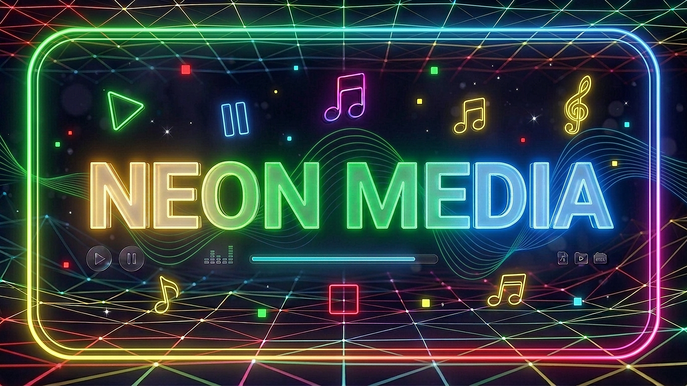

# NeonMediaApplication

Neon Media Player — кроссплатформенный медиаплеер для воспроизведения аудио и видео, редактирования метаданных медиафайлов и извлечения аудио из видеофайлов.

Проект находится в состоянии разработки.

## Основной функционал

- Воспроизведение аудио и видео (интеграция с движком VLC).
- Поддержка популярных форматов медиафайлов (MP3, MP4, AVI, MKV и др.).
- Создание и управление плейлистами.
- Извлечение аудио из видеофайлов.
- Конвертация форматов.
- Редактирование метаданных медиафайлов (название, артист, альбом, жанр, обложка альбома и т.д.).
- Работа приложения в фоновом режиме.

## Поддерживаемые форматы

Обозначения в таблицах:
- **+** поддерживается
- **-** не поддерживается
- **Чтение** только чтение тегов
- **Ограниченно** частичная поддержка

### Аудио

| Формат (расширение) | Воспроизведение (LibVLC) | Извлечение аудио (FFmpeg.AutoGen) | Редактирование тегов (TagLibSharp) |
|---------------------|--------------------------|-----------------------------------|------------------------------------|
| MP3 | + | + (кодирование через LAME) | + (ID3v1/ID3v2) |
| WAV | + | + (PCM, ADPCM) | + (RIFF INFO / ID3v2) |
| FLAC | + | + (lossless) | + (Vorbis Comments) |
| AAC | + | + (кодирование через libfaac) | + (в контейнере MP4/M4A) |
| OGG (Vorbis) | + | + | + (Vorbis Comments) |
| OGG (Opus) | + | + | + (Vorbis Comments) |
| M4A / ALAC | + | + | + (iTunes atoms) |
| WMA | + | + | + (ASF) |
| AIFF | + | + | + (ID3v2) |
| APE (Monkey's Audio) | + | + | + |
| WavPack | + | + | + |
| Musepack | + | + | + |
| AC3 / E-AC3 | + | + | - (нет редактирования тегов) |
| DTS | + | + | - |
| Speex | + | + | - |
| RealAudio | + | + | - |

Ключевые аудиокодеки, поддерживаемые через LibVLC/FFmpeg:
AAC, AC3, ALAC, AMR, DTS, FLAC, MP3, Opus, Vorbis, WMA, WavPack, Speex, APE, Musepack.

### Видео

| Формат (расширение) | Воспроизведение (LibVLC) | Извлечение аудио (FFmpeg.AutoGen) | Редактирование тегов (TagLibSharp) |
|---------------------|--------------------------|-----------------------------------|------------------------------------|
| MP4 | + | + | + (iTunes atoms) |
| MKV (Matroska) | + | + | + (через теги Matroska) |
| AVI | + | + | + (RIFF INFO) |
| MOV | + | + | + (iTunes atoms, в контейнере MP4) |
| WMV / ASF | + | + | + (ASF) |
| WebM | + | + | Чтение |
| FLV | + | + | - |
| TS (MPEG-TS) | + | + | - |
| OGV (Ogg Video) | + | + | + (Vorbis Comments) |
| MPEG (ES/PS/TS) | + | + | - |
| 3GP | + | + | Ограниченно |
| DVD ISO / VOB | + | + | - |

Ключевые видеокодеки, поддерживаемые через LibVLC/FFmpeg:
H.264/AVC, H.265/HEVC, VP8, VP9, AV1, MPEG-2, MPEG-4, ProRes, а также аппаратное декодирование через NVIDIA (CUVID/NVDEC), Intel Quick Sync (QSV), AMD AMF, VAAPI, Vulkan.

## Технологический стек

- Язык: C# (.NET 10).
- Фреймворк интерфейса: Avalonia.
- Архитектурный паттерн: MVVM (CommunityToolkit.Mvvm).
- Управление жизненным циклом / DI: Microsoft.Extensions.Hosting.

## Библиотеки

| Назначение | Пакет NuGet | Версия |
|------------|-------------|--------|
| MVVM | CommunityToolkit.Mvvm | 8.4.2 |
| Хостинг / DI | Microsoft.Extensions.Hosting | 10.0.13 |
| Извлечение аудио (in-process) | FFmpeg.AutoGen | 9.0.x |
| Метаданные | TagLibSharp | 2.2.0 |
| Движок VLC | LibVLCSharp, LibVLCSharp.Avalonia | 3.9.x |

## Документация

- https://docs.videolan.me/libvlcsharp/
- https://taglib.org/
